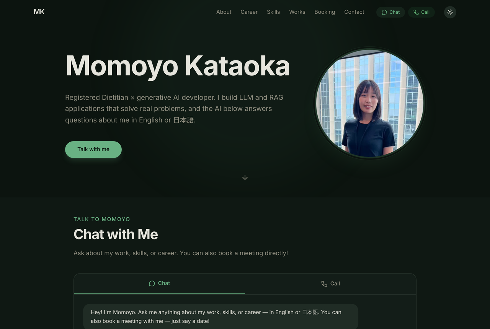
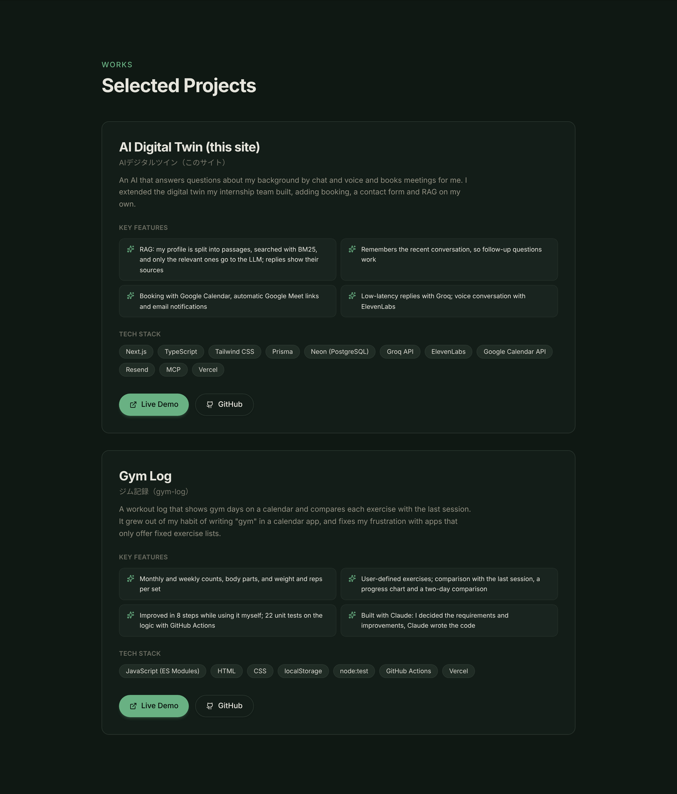
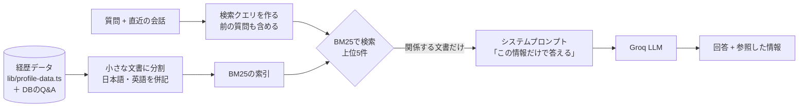

# AI Digital Twin — a portfolio that answers for me

A portfolio site where an AI version of me (Momoyo Kataoka) answers questions about my background, skills and projects by chat and voice, and books meetings. Answers are grounded in my own profile data through a **RAG** pipeline.

**Demo: https://momoyo-ai.vercel.app** (ask in English or Japanese)

[](https://github.com/momo23546842/ai-portfolio-platform/actions/workflows/test.yml)

> 🇯🇵 [日本語版はこちら](#japanese)



## Background

During an AI agent development internship in Australia (AusBiz Consulting), my team built a "digital twin" focused on chat and voice conversation. I was the team leader.

After the internship I rebuilt it as a personal project. A normal portfolio only lists information; letting visitors ask what they actually want to know is a more natural way to show who I am. On my own I added:

- Meeting booking with Google Calendar (a Google Meet link is created automatically)
- A contact form with email notifications
- RAG grounded in my profile data, and conversation memory

## Features

| Feature | Details |
|---|---|
| Answers by chat and voice | Career, internships, projects, skills and certifications. Both chat and voice calls work in English and Japanese (pick the language before a call); speech uses ElevenLabs' multilingual model |
| Grounded answers (RAG) | Only the profile passages relevant to the question are sent to the LLM. The sources are shown under each answer |
| Follow-up questions | Recent turns are remembered, so "What tech did you use there?" works |
| Says when it doesn't know | Questions the profile doesn't cover (e.g. "What are your hobbies?") get no guess, but an offer to meet |
| Meeting booking | Ask "Are you free on March 10?" to see open slots and book. A Google Meet link and email notifications are sent automatically |
| Tools for AI agents (MCP) | External agents, such as a voice agent, can call profile search as a tool |



## How the RAG works

```mermaid
flowchart LR
  U[Question + recent turns] --> Q[Build the search query<br/>including the previous question]
  K[(Profile data<br/>lib/profile-data.ts<br/>+ Q&A in the DB)] --> C[Split into small passages<br/>English and Japanese]
  C --> I[BM25 index]
  Q --> S{BM25 search<br/>top 5}
  I --> S
  S -->|relevant passages only| P[System prompt<br/>"answer only from this"]
  P --> L[Groq LLM]
  L --> R[Answer + sources]
```

1. **Split the profile into small passages:** one job, one project or one Q&A per passage. Each passage holds both English and Japanese, so questions in either language find it.
2. **Find the relevant passages:** BM25 scores how well each passage matches the question. The previous question is searched too, so follow-ups keep the topic.
3. **Send only those passages to the LLM:** the prompt says to answer only from them and not to guess. Short prompts are faster and cheaper.
4. **Return the sources:** the page shows which passages the answer came from.

## Design decisions

- **BM25 instead of vector search:** there are only a few dozen passages, and Groq has no embeddings API. BM25 needs no extra service or database change, and its results are easy to explain. If the data grows, I plan to add vector search with pgvector on Neon.
- **Japanese search:** Japanese has no spaces between words, so kanji and katakana are indexed as overlapping pairs. Hiragana is mostly particles and endings (について, ですか) that match every passage, so it is treated as a separator. This stopped the assistant from forcing an answer to unrelated questions.
- **One source of profile data:** the page, the database and the AI prompt each had their own copy of my career, and they disagreed. `lib/profile-data.ts` is now the single source that the page, the chat and the MCP tools all read.
- **Conversation memory in the browser:** the server keeps no conversation state; the browser sends recent turns each time, so it works on serverless (Vercel) with no extra storage. The server doesn't trust the history: it checks the format and limits length and count.
- **Safety and cost:**
  - Messages are capped at 1,000 characters and 20 per minute per visitor, to keep the Groq bill under control.
  - Removed a leftover test API that let anyone send email to any address.
  - All API keys live in environment variables, never in the repository.

## Tech stack

| Area | Technology |
|---|---|
| Frontend | Next.js (App Router), React, TypeScript, Tailwind CSS |
| Backend | Next.js API Routes, Prisma, Neon (PostgreSQL) |
| Generative AI | Groq API (LLM), RAG (BM25, written from scratch), ElevenLabs (voice), MCP |
| Services | Google Calendar API, Google Meet, Resend (email) |
| Tests and CI | Node.js built-in test runner, GitHub Actions |
| Hosting | Vercel |

```
lib/
  profile-data.ts   career, projects, skills and Q&A (shared by the page and the AI)
  rag.ts            splitting, indexing, BM25 search, history validation (no dependencies)
  voice.ts          voice call language: locale, fixed spoken lines, shortening replies for speech
  prisma.ts         database client
app/api/
  chat/             chat API (search → prompt → Groq → answer and sources)
  mcp/              tools for AI agents (profile search and more)
  booking/          availability and booking (Google Calendar)
  contact/          contact form
  elevenlabs/       text to speech
components/         page sections
tests/              search, history and voice tests
```

## Tests

```bash
npm test
```

The tests cover search (the right passage for English and Japanese questions, follow-ups, nothing for unrelated questions), greetings, history validation, and date consistency in the profile data. They use only Node.js 22, with no extra libraries, and run on every push with GitHub Actions.

## Running locally

```bash
npm install
npm run dev
```

Set these in `.env`:

| Variable | Used for |
|---|---|
| `DATABASE_URL` | Neon (PostgreSQL) connection |
| `GROQ_API_KEY`, `GROQ_MODEL` | LLM (defaults to `llama-3.1-8b-instant`) |
| `ELEVENLABS_API_KEY`, `VOICE_ID`, `ELEVENLABS_MODEL` | Voice (model defaults to `eleven_multilingual_v2`) |
| `GOOGLE_SERVICE_ACCOUNT_EMAIL`, `GOOGLE_PRIVATE_KEY`, `GOOGLE_CALENDAR_ID` | Booking (Google Calendar) |
| `GOOGLE_OAUTH_CLIENT_ID`, `GOOGLE_OAUTH_CLIENT_SECRET`, `GOOGLE_OAUTH_REDIRECT_URI`, `GOOGLE_OAUTH_REFRESH_TOKEN` | Google Meet links |
| `RESEND_API_KEY`, `RESEND_FROM`, `RESEND_NOTIFY_TO`, `CONTACT_NOTIFY_EMAIL` | Email notifications |

On Vercel, set them for both Production and Preview, and redeploy after changing them.

## How it was built

- It started from the team project in my internship (a chat and voice digital twin). As team leader I assigned tasks, tracked progress and ran the meetings.
- For the personal extension (booking, contact, RAG, conversation memory, one source of profile data) I decided what to build and how far to take it, and implemented it with AI tools such as Claude. Problems and fixes are logged in [`.doc/PROGRESS.md`](.doc/PROGRESS.md) — for example, replacing the Google API client, which was too large to run on Vercel, with the REST API and hand-written auth.

## Next steps

- **Vector search:** hybrid search with BM25 and pgvector on Neon for when the data grows
- **Answer quality checks:** a set of expected questions and answers to measure search and answer accuracy automatically
- **Phone calls:** call a phone number and talk to the AI, using Vapi

---

<a id="japanese"></a>

## 日本語版

私（片岡 桃世）の経歴・スキル・作品について、AIがチャットと音声で答え、ミーティングの予約まで行うポートフォリオサイトです。答えは、私の経歴データを検索して根拠にする**RAG**の仕組みで作っています。

### 作った背景

オーストラリアでのAIエージェント開発インターン（AusBiz Consulting）で、チームで「デジタルツイン」を開発しました。チームではチャットと音声の会話が中心でした。

インターンのあと、これを個人のプロジェクトとして作り直しました。ふつうのポートフォリオは情報を一方的に並べるだけですが、見る人が知りたいことを会話で聞けるほうが、私という人をより自然に伝えられると考えたからです。個人では、次の機能を足しました。

- Googleカレンダーと連携したミーティング予約（Google Meetのリンクも自動で作る）
- 問い合わせフォームとメール通知
- 経歴データを根拠に答えるRAGと、会話の記憶

### できること

| 機能 | 内容 |
|---|---|
| チャット・音声で質問に答える | 経歴、インターン、作品、スキル、資格などに答えます。チャットも音声通話も日本語・英語に対応しています（通話の前に言語を選びます）。音声はElevenLabsの多言語モデルで読み上げます |
| 根拠のある回答（RAG） | 質問に関係する経歴データだけを検索してLLMに渡します。回答の下に「参照した情報」を表示します |
| 続けての質問 | 直近の会話を覚えているので、「その時に使った技術は？」のような質問にも答えられます |
| 知らないことは知らないと言う | 経歴データにない質問（例：「趣味は？」）には推測で答えず、ミーティングを案内します |
| ミーティング予約 | チャットで「3月10日空いてる？」と聞くと空き時間を表示し、そのまま予約できます。Google Meetのリンクとメール通知を自動で送ります |
| AIエージェント向けのツール（MCP） | 音声エージェントなど外部のAIから、プロフィール検索を道具として呼び出せます |


### RAGの仕組み



1. **経歴データを小さな文書に分ける：** 職歴1件、作品1件、Q&A1件などを、それぞれ1つの文書にします。各文書は日本語と英語の両方で書いてあるので、どちらの言語の質問でも見つかります。
2. **質問に関係する文書を探す：** BM25という検索方式で、質問と各文書の一致度を点数にします。直前の質問もいっしょに検索するので、「その時に〜」のような続けての質問でも話題を見失いません。
3. **見つかった文書だけをLLMに渡す：** 「この情報だけを使って答え、ないことは推測しない」と指示します。プロンプトが短くなるので、速く安く答えられます。
4. **参照した情報を返す：** どの文書をもとに答えたかを画面に表示します。

### 設計で判断したこと

- **ベクトル検索ではなくBM25を選んだ：** 文書は数十件と少なく、使っているGroqには埋め込み（ベクトル化）のAPIがありません。BM25なら追加のサービスやデータベースの変更なしで動き、検索結果の理由も説明しやすいです。文書が増えたら、Neonのpgvectorでベクトル検索を足すことを考えています。
- **日本語の検索の工夫：** 日本語は単語の区切りがないので、漢字・カタカナを2文字ずつ区切って索引にしています。ひらがなは「について」「ですか」のような助詞・語尾がほとんどで、どの文書にも一致して検索を邪魔するため、区切りとして扱います。この工夫で、「趣味は何ですか？」のような関係のない質問に、無理やり答えないようになりました。
- **経歴データを1か所にまとめた：** 以前は、画面の経歴、データベース、AIへの指示文に別々に経歴が書かれていて、内容が食い違っていました。`lib/profile-data.ts` を唯一の元データにして、画面の表示・AIの回答・MCPのツールがすべてここを読むようにしました。
- **会話の記憶はブラウザ側に持つ：** サーバーは会話を覚えず、ブラウザが直近の会話を毎回送ります。サーバーレス（Vercel）でも追加の保存先なしで動きます。送られてきた履歴は信用せず、形式を確かめ、長さと件数を制限してから使います。
- **安全とコストへの配慮：**
  - 1回の質問は1,000文字まで、同じ人からの連続した質問は1分20回までに制限し、Groqの利用料が膨らまないようにしています。
  - 誰でも任意の宛先にメールを送れてしまう開発用のテストAPIが残っていたので削除しました。
  - APIキーはすべて環境変数で管理し、リポジトリには含めていません。

### 技術構成

| 分類 | 技術 |
|---|---|
| フロントエンド | Next.js (App Router)、React、TypeScript、Tailwind CSS |
| バックエンド | Next.js API Routes、Prisma、Neon (PostgreSQL) |
| 生成AI | Groq API（LLM）、RAG（BM25、自前実装）、ElevenLabs（音声）、MCP |
| 外部サービス | Google Calendar API、Google Meet、Resend（メール） |
| テスト・CI | Node.js標準のテストランナー、GitHub Actions |
| 公開 | Vercel |

```
lib/
  profile-data.ts   経歴・作品・スキル・Q&A（画面とAIの共通の元データ）
  rag.ts            分割・索引・BM25検索・会話履歴の検証（外部依存なし）
  voice.ts          音声通話の言語（認識する言語、決まった読み上げ文、読み上げ用の短縮）
  prisma.ts         データベース接続
app/api/
  chat/             チャットAPI（検索 → プロンプト → Groq → 回答と参照元）
  mcp/              AIエージェント向けツール（プロフィール検索など）
  booking/          空き時間の確認・予約作成（Google Calendar）
  contact/          問い合わせ
  elevenlabs/       音声合成
components/         画面の各セクション
tests/              検索・会話履歴・音声のテスト
```

### テスト

```bash
npm test
```

検索のテスト（日本語・英語の質問で正しい文書が見つかるか、続けての質問、関係のない質問で何も返さないか）、あいさつへの対応、会話履歴の検証、経歴データの日付の整合性などを確かめています。追加のライブラリは使わず、Node.js 22の機能だけで動きます。pushのたびにGitHub Actionsで自動実行されます。

### ローカルで動かす

```bash
npm install
npm run dev
```

`.env` に次の環境変数を設定します。

| 変数 | 用途 |
|---|---|
| `DATABASE_URL` | Neon (PostgreSQL) の接続先 |
| `GROQ_API_KEY`, `GROQ_MODEL` | LLM（モデルを省略すると `llama-3.1-8b-instant`） |
| `ELEVENLABS_API_KEY`, `VOICE_ID`, `ELEVENLABS_MODEL` | 音声（モデルを省略すると `eleven_multilingual_v2`） |
| `GOOGLE_SERVICE_ACCOUNT_EMAIL`, `GOOGLE_PRIVATE_KEY`, `GOOGLE_CALENDAR_ID` | 予約（Google Calendar） |
| `GOOGLE_OAUTH_CLIENT_ID`, `GOOGLE_OAUTH_CLIENT_SECRET`, `GOOGLE_OAUTH_REDIRECT_URI`, `GOOGLE_OAUTH_REFRESH_TOKEN` | Google Meetのリンク作成 |
| `RESEND_API_KEY`, `RESEND_FROM`, `RESEND_NOTIFY_TO`, `CONTACT_NOTIFY_EMAIL` | メール通知 |

### 開発の進め方

- インターンでのチーム開発（チャット・音声のデジタルツイン）がもとになっています。私はチームリーダーとして、タスクの割り振り、進捗管理、ミーティングの運営を担当しました。
- 個人での拡張（予約・問い合わせ・RAG・会話の記憶・経歴データの一本化）は、何を作るか、どこまで作るかを自分で決め、ClaudeなどのAIを使いながら実装しました。開発中に起きた問題と解決は [`.doc/PROGRESS.md`](.doc/PROGRESS.md) に記録しています（例：Vercelでパッケージが大きすぎて動かなかったGoogle APIを、REST APIと自前の認証に置き換えた）。

### 今後やりたいこと

- **ベクトル検索の追加：** 文書が増えたときのために、BM25とNeonのpgvectorを組み合わせたハイブリッド検索
- **回答の品質評価：** 想定質問と正解の組を用意して、検索と回答の正確さを自動で測る
- **電話での会話：** Vapiを使い、電話番号に発信してAIと話せるようにする
